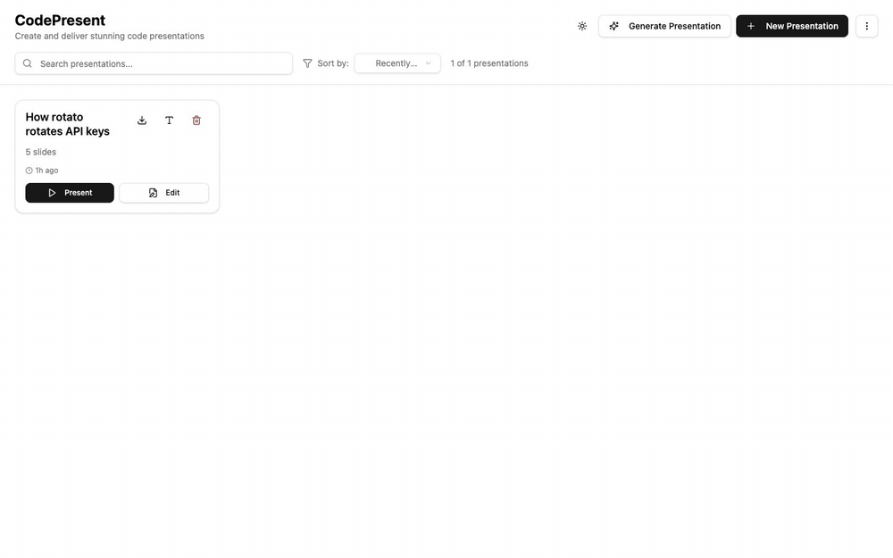
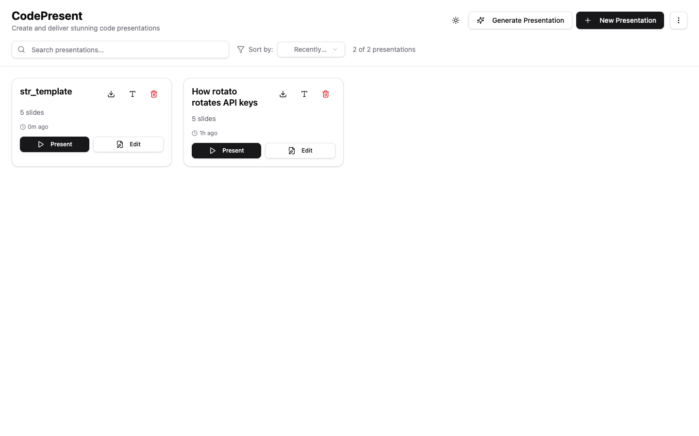
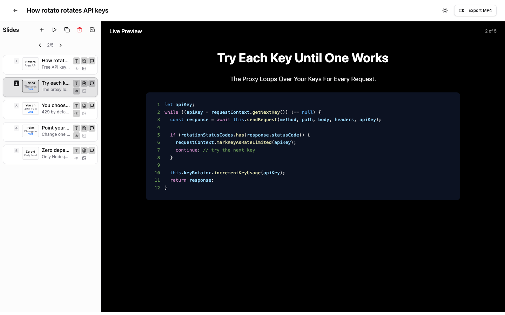
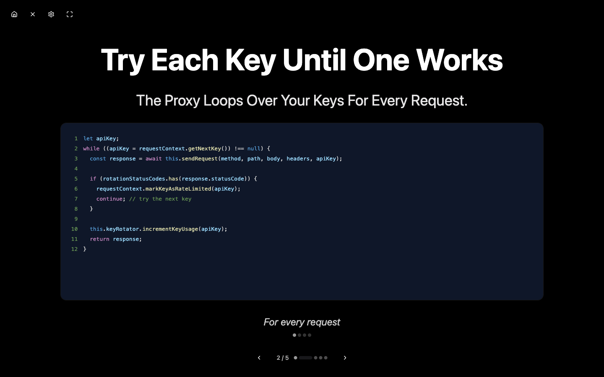
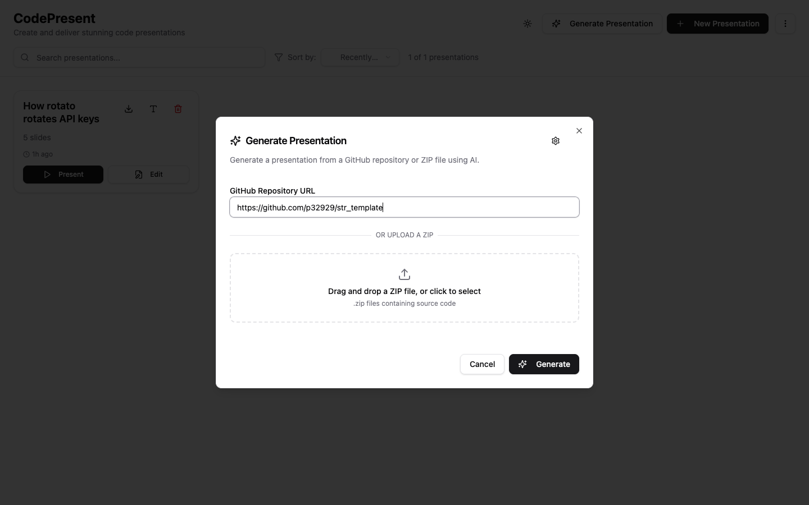
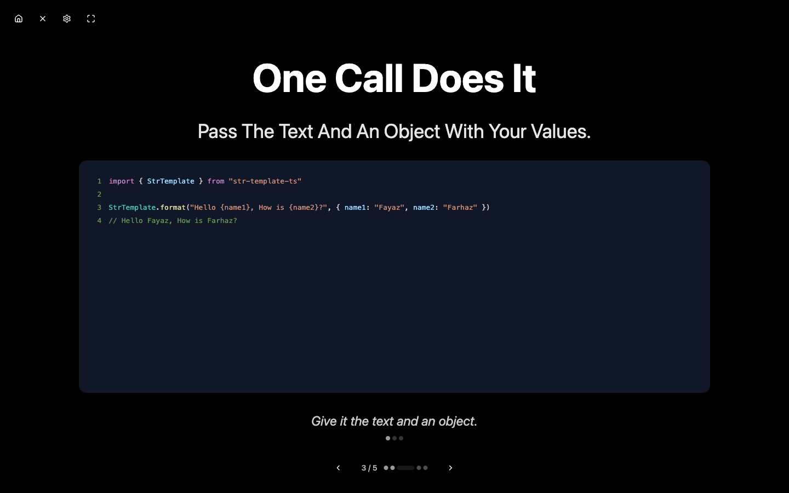
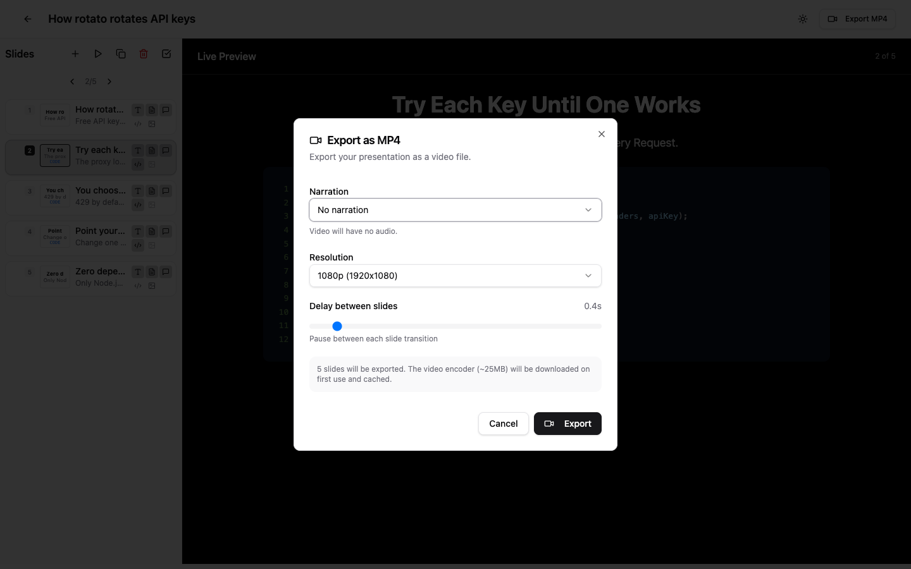
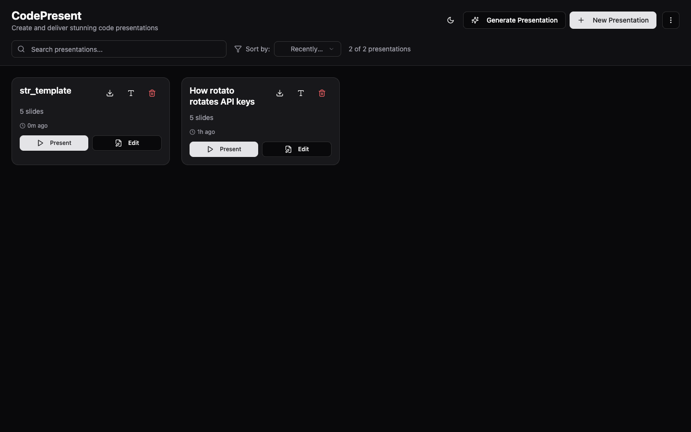
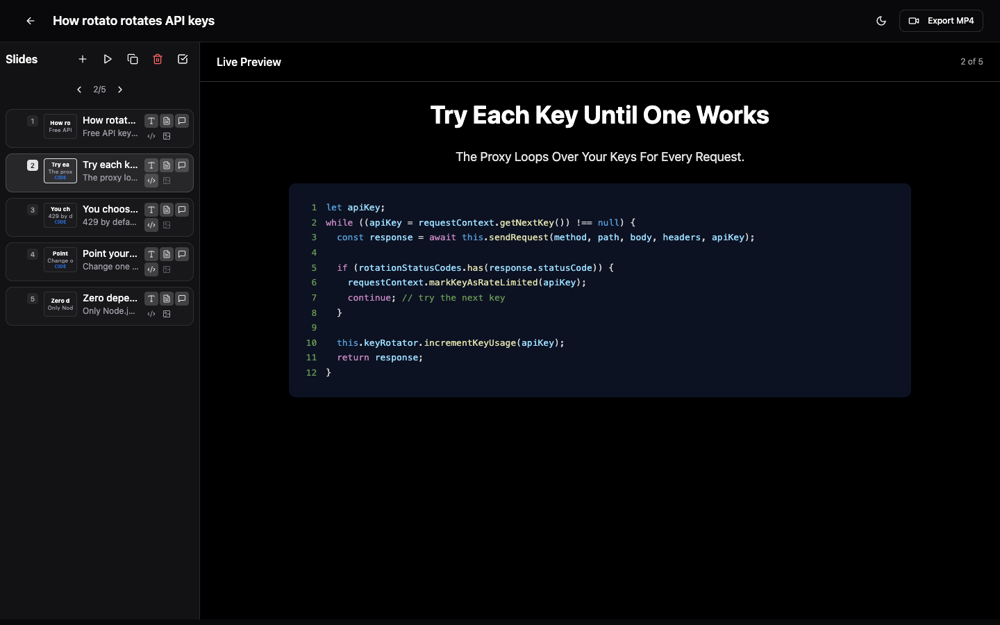

# CodePresent

CodePresent turns code into slides and short videos, right in your browser. It is for developers who explain code: tutorials, YouTube videos and shorts, team onboarding, or a talk.

Putting code on slides usually means pasting screenshots and fighting with formatting, and turning that into a video takes even longer. With CodePresent you write slides with real syntax-highlighted code, or let AI read a GitHub repo or a ZIP file and draft the whole deck for you. Then you present it full screen, or export it as an MP4 video, with spoken narration if you want it.

**Everything runs in your browser.** Your presentations, your API keys and the video encoding all stay on your own computer. You bring your own keys for any OpenAI-compatible model, and Gemini for the voice.

<p align="center"><b><a href="https://p32929.github.io/code_present_reactts/">Try it in your browser →</a></b><br>No sign-up, nothing to install.</p>

<p align="center"></p>

<p align="center"><b><a href="docs/example.mp4">Watch an example video</a></b>: this 30-second MP4 was exported by CodePresent itself, from the slides in the demo above.</p>

## Screenshots

<p>


</p>
<p>


</p>
<p>


</p>
<p>


</p>

## How it works

1. **Make a presentation.** Start with an empty one and add slides, or paste a GitHub repo link (or upload a ZIP) and let AI write the slides for you.
2. **Edit the slides.** Each slide has a title, a short line, a narration script, and either a code block or an image. You see a live preview as you type.
3. **Present it.** Play mode shows the slides full screen, with the narration as captions one line at a time. Move with the arrow keys or the space bar.
4. **Export a video.** Pick 1080p or 720p, the pause between slides, and optional Gemini narration. The MP4 is made in your browser and downloads when it is done.

## Features

1. **Slides with real code:** syntax-highlighted code blocks, titles, short descriptions, narration lines and images.
2. **Generate from a repo:** paste a GitHub repository link or upload a ZIP, and AI drafts the whole presentation.
3. **Full-screen play mode:** keyboard controls, a slide strip, and settings for text size and spacing.
4. **Export as a video:** MP4 at 1080p or 720p, with optional spoken narration (Gemini text to speech) and your own delay between slides.
5. **Use any AI you like:** an OpenAI-compatible text model writes the slides, Gemini reads them out, and any OpenAI-compatible image models can draw pictures for them.
6. **Keep and share your work:** rename, delete, search and sort presentations, and export them as JSON to import again later.
7. **Light and dark mode.**

## Run it

The easiest way is the live version: [p32929.github.io/code_present_reactts](https://p32929.github.io/code_present_reactts/). To run it on your own computer, you need [Node.js](https://nodejs.org/).

```bash
git clone https://github.com/p32929/code_present_reactts.git
cd code_present_reactts
yarn          # or npm install
yarn dev      # or npm run dev
```

Then open the address it prints. To make a production build, run `yarn build`.

## Set up the AI features

Open **AI Settings** in the generate dialog and fill in:

1. **Text model:** an OpenAI-compatible base URL, API key and model name. This writes the slides.
2. **Voice (optional):** one or more Gemini API keys for the spoken narration.
3. **Images (optional):** an OpenAI-compatible base URL, key and one or more image model names.

You can make and present slides without any of these. They are only needed for the AI features.

## Good to know

1. Data lives in your browser's storage. Clearing the site data deletes your presentations, so export the ones you want to keep.
2. Very large repos are trimmed: only code files are read, up to 100 KB per file and 500 KB in total.

Built with React, TypeScript, Vite, Tailwind and ffmpeg.wasm.

## Contributing

Contributions are very welcome. Please open an issue first to talk about what you'd like to add or change, so we can agree on it before you spend time on a pull request. Thank you!

<p><a href="https://p32929.github.io/share/?repo=code_present_reactts"><picture><source media="(prefers-color-scheme: dark)" srcset="https://p32929.github.io/readme/footer-share-dark.svg"></picture></a><a href="https://p32929.github.io/support/"><picture><source media="(prefers-color-scheme: dark)" srcset="https://p32929.github.io/readme/footer-support-dark.svg"></picture></a><br><a href="https://openstore.pfay.workers.dev/add"><picture><source media="(prefers-color-scheme: dark)" srcset="https://p32929.github.io/readme/footer-join-dark.svg"></picture></a></p>
